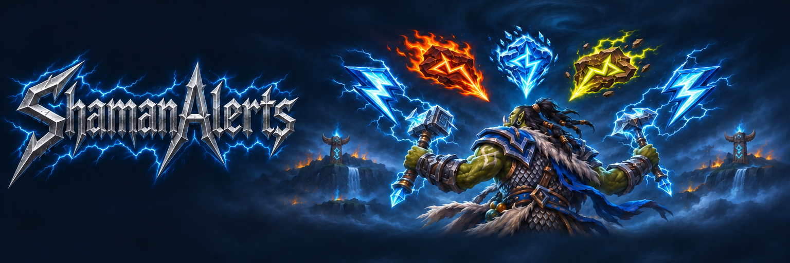

# ShamanAlerts

**Alerts around your character, made for Enhancement Shamans on WoW Forever.**

ShamanAlerts shows large, glowing symbols next to your character at the moment something needs your attention: Maelstrom Weapon is full, Flame Shock is about to run out, Stormstrike is ready, your shield is gone. You keep your eyes on the fight instead of on the action bars.

The interface of the addon is in German.

## What it shows

- **Maelstrom Weapon** at full stacks
- **Flame Shock missing** on your target, already two seconds before it runs out
- **Frost Shock missing** when your target is a player
- **Shock ready** for everything else, and **Interrupt** when your target casts something you can stop
- **Stormstrike ready** and **Fire Nova ready** (only with enough enemies around you)
- **Lightning Shield missing** and **weapon enchant missing**, off hand included
- **Clearcasting**, **Flurry**, **Blood Fury** and **Berserking**
- A **totem bar** with your active totems and a row of totem cooldowns

The shocks follow an order, so only the most important one is shown: Interrupt first, then Frost Shock against players, then Flame Shock, then the general shock. They share one place on screen, only the picture changes.

## Graphics and sound

- 159 graphics made for this addon, 53 of them in the style of WoW ability icons
- Place every alert where you want it: in the centre, as an arc, on both sides or all around your character
- Size, colour, glow, pulse, rotation and mirroring per alert
- A sound per alert, with your LibSharedMedia sounds if you have them

## Conditions

Each alert can be limited: in combat only, only with enough mana, only in range, only while your target casts, only with a number of enemies nearby, only above a health threshold of your target, only against players or never against players.

## Your own alerts

Create alerts for any buff, debuff or spell: "is active", "is missing", "from X stacks" or "spell ready". They get the same graphics, positions, conditions and sounds as the built-in ones.

## Profiles and sharing

Save your whole setup as a profile and load it again later. Export it as a short text and send it to a friend, who imports it with one click. Importing never runs code: the text is read character by character and only settings the addon knows are taken over.

## Installation

1. Download `ShamanAlerts-<version>.zip` from the [latest release](https://github.com/Koruyo/ShamanAlerts/releases/latest).
2. Extract it into `World of Warcraft\_forever_\Interface\AddOns`, so that the folder `ShamanAlerts` lies directly inside `AddOns`.
3. Start the game (a running game has to be restarted completely) and type `/sha`.

## How to open it

- `/sha` opens the options
- Minimap button: left click for the options, right click for the totem bar
- Options > AddOns > ShamanAlerts
- `/sha help` lists all commands

## Using your own pictures

You can use any picture as an alert, your own or one that another addon brings along.

1. Save the picture as **TGA** (32 bit, with alpha channel) or **BLP**. Width and height must be powers of two, for example 256 x 256 or 512 x 512.
2. Put it into a folder of its own inside `Interface\AddOns`, for example `Interface\AddOns\MyPictures\bolt.tga`. Do not put it into the ShamanAlerts folder: an update of the addon replaces that folder.
3. Restart the game completely. The game only notices new files when it starts; `/reload` is not enough.
4. Open `/sha`, pick the alert, go to the tab "Grafik" and type the path into the field "Eigener Pfad", for example `Interface\AddOns\MyPictures\bolt.tga`. Press Enter.

Pictures from other addons work the same way: type the path of the file inside that addon's folder, for example `Interface\AddOns\OtherAddon\Media\ring.tga`. Icons of the game work too, for example `Interface\Icons\Spell_Nature_Lightning`.

Pictures added this way are not listed in the picture browser of the addon; they are chosen by their path. A path is part of your profile and of an export, but the file itself is not: whoever imports your export needs the same file in the same place.

## If something does not show

Type `/sha status` for the state of every alert. For a closer look, go into the situation where it fails, type `/sha debug`, wait for "Diagnose fertig" in the chat and type `/reload`. The recording is then stored with your settings.

## Credits

The graphics were made for ShamanAlerts with the image generation of ChatGPT (Codex). All sounds were computed for ShamanAlerts.

## Changes and license

All changes are listed in [CHANGELOG.md](CHANGELOG.md) (in German). ShamanAlerts is released under the [MIT License](LICENSE).

---

## Deutsch

**Alarme rund um den Charakter, gemacht für Verstärker-Schamanen auf WoW Forever.**

ShamanAlerts zeigt große, leuchtende Symbole neben deinen Charakter, sobald etwas deine Aufmerksamkeit braucht: Waffe des Mahlstroms ist voll, der Flammenschock läuft gleich aus, Sturmschlag ist bereit, dein Schild fehlt. Dein Blick bleibt im Kampf statt auf den Aktionsleisten.

### Was es zeigt

- **Waffe des Mahlstroms** bei vollen Stapeln
- **Flammenschock fehlt** auf dem Ziel, schon zwei Sekunden bevor er ausläuft
- **Frostschock fehlt**, wenn dein Ziel ein Spieler ist
- **Schock bereit** für alles Übrige und **Unterbrechen**, sobald dein Ziel etwas Unterbrechbares zaubert
- **Sturmschlag bereit** und **Feuernova bereit** (nur mit genug Gegnern um dich)
- **Blitzschlagschild fehlt** und **Waffenverzauberung fehlt**, auch für die Nebenhand
- **Freizaubern**, **Schlaghagel**, **Kochendes Blut** und **Berserker**
- Eine **Totem-Leiste** mit deinen stehenden Totems und einer Reihe für Totem-Abklingzeiten

Die Schocks haben eine Rangfolge, damit immer nur der wichtigste erscheint: zuerst Unterbrechen, dann Frostschock gegen Spieler, dann Flammenschock, dann der allgemeine Schock. Sie teilen sich eine Stelle auf dem Bildschirm, es wechselt nur das Bild.

### Grafik und Sound

- 159 Grafiken, eigens für dieses Addon erstellt, davon 53 im Stil der Fähigkeitssymbole von WoW
- Jeder Alarm steht, wo du ihn haben willst: in der Mitte, als Bogen, auf beiden Seiten oder rund um den Charakter
- Größe, Farbe, Leuchten, Pulsieren, Drehung und Spiegelung je Alarm
- Ein Sound je Alarm, auf Wunsch aus deinen LibSharedMedia-Sounds

### Bedingungen

Jeder Alarm lässt sich einschränken: nur im Kampf, nur mit genug Mana, nur in Reichweite, nur solange das Ziel zaubert, nur mit einer Zahl von Gegnern in der Nähe, nur über einer Lebens-Schwelle des Ziels, nur gegen Spieler oder nie gegen Spieler.

### Eigene Alarme

Leg Alarme für beliebige Buffs, Debuffs oder Zauber an: „ist aktiv", „fehlt", „ab X Stapeln" oder „Zauber bereit". Sie bekommen dieselben Grafiken, Positionen, Bedingungen und Sounds wie die eingebauten.

### Profile und Austausch

Speichere deine ganze Einrichtung als Profil und lade sie später wieder. Exportiere sie als kurzen Text und schick ihn einem Freund, der ihn mit einem Klick importiert. Beim Import wird nie etwas ausgeführt: Der Text wird Zeichen für Zeichen gelesen, und übernommen wird nur, was das Addon kennt.

### Installation

1. Lade `ShamanAlerts-<Version>.zip` aus dem [neuesten Release](https://github.com/Koruyo/ShamanAlerts/releases/latest).
2. Entpacke die Datei nach `World of Warcraft\_forever_\Interface\AddOns`, sodass der Ordner `ShamanAlerts` direkt in `AddOns` liegt.
3. Starte das Spiel (ein laufendes Spiel muss ganz neu gestartet werden) und tipp `/sha`.

### So öffnest du es

- `/sha` öffnet die Optionen
- Knopf an der Minimap: Linksklick für die Optionen, Rechtsklick für die Totem-Leiste
- Optionen > AddOns > ShamanAlerts
- `/sha help` listet alle Befehle

### Eigene Bilder verwenden

Du kannst jedes Bild als Alarm verwenden, ein eigenes oder eines, das ein anderes Addon mitbringt.

1. Speichere das Bild als **TGA** (32 Bit, mit Alphakanal) oder **BLP**. Breite und Höhe müssen Zweierpotenzen sein, zum Beispiel 256 x 256 oder 512 x 512.
2. Leg es in einen eigenen Ordner unter `Interface\AddOns`, zum Beispiel `Interface\AddOns\MeineBilder\blitz.tga`. Nicht in den Ordner von ShamanAlerts: Ein Update des Addons ersetzt diesen Ordner.
3. Starte das Spiel ganz neu. Neue Dateien bemerkt das Spiel erst beim Start; `/reload` reicht nicht.
4. Öffne `/sha`, wähl den Alarm, geh auf den Reiter „Grafik" und trag den Pfad in das Feld „Eigener Pfad" ein, zum Beispiel `Interface\AddOns\MeineBilder\blitz.tga`. Die Eingabetaste übernimmt.

Bilder aus anderen Addons gehen genauso: Trag den Pfad der Datei im Ordner dieses Addons ein, zum Beispiel `Interface\AddOns\AnderesAddon\Media\ring.tga`. Auch Symbole des Spiels gehen, zum Beispiel `Interface\Icons\Spell_Nature_Lightning`.

Bilder, die du so einträgst, stehen nicht in der Bildauswahl des Addons; gewählt werden sie über ihren Pfad. Der Pfad gehört zu deinem Profil und zu einem Export, die Datei selbst nicht: Wer deinen Export importiert, braucht dieselbe Datei an derselben Stelle.

### Wenn etwas nicht erscheint

`/sha status` schreibt den Zustand jedes Alarms in den Chat. Für einen genaueren Blick: Geh in die Lage, in der es schiefgeht, tipp `/sha debug`, warte auf „Diagnose fertig" im Chat und tipp `/reload`. Die Aufzeichnung liegt dann bei deinen Einstellungen.

### Dank

Die Grafiken wurden für ShamanAlerts mit der Bilderzeugung von ChatGPT (Codex) erstellt. Alle Sounds wurden für ShamanAlerts berechnet.

### Änderungen und Lizenz

Alle Änderungen stehen in [CHANGELOG.md](CHANGELOG.md). ShamanAlerts steht unter der [MIT-Lizenz](LICENSE).
