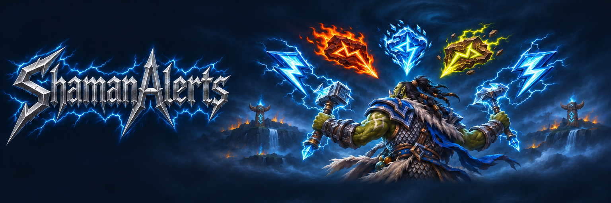

## Keep your eyes on the fight

ShamanAlerts shows large, glowing symbols next to your character at the moment something
needs your attention: Maelstrom Weapon is full, Flame Shock is about to run out, Stormstrike is
ready, your shield is gone. You keep your eyes on the fight instead of on the action bars.

- **Maelstrom Weapon** at full stacks
- **Flame Shock missing** on your target, already two seconds before it runs out
- **Frost Shock missing** when your target is a player
- **Shock ready** for everything else, and **Interrupt** when your target casts something you
  can stop
- **Stormstrike ready** and **Fire Nova ready** (only with enough enemies around you)
- **Lightning Shield missing** and **weapon enchant missing**, off hand included
- **Clearcasting**, **Flurry**, **Blood Fury** and **Berserking**
- **Totem bar** with your active totems and a row of totem cooldowns
- **One place for the shocks**: they follow an order (Interrupt, Frost Shock against players,
  Flame Shock, general shock), so only the most important one is shown and only the picture
  changes.
- **185 graphics** made for this addon: 53 in the style of WoW ability icons, 14 plain ones and
  12 Maelstrom Weapon pictures that build up piece by piece with every stack. Place
  every alert in the center, as an arc, on both sides or all around your character, and set
  size, color, glow, pulse, rotation and mirroring per alert.
- **Sounds** per alert, with your LibSharedMedia sounds if you have them.
- **Conditions** per alert: in combat only, enough mana, in range, target is casting, number of
  enemies nearby, target health, only against players or never against players.
- **Your own alerts** for any buff, debuff or spell: "is active", "is missing", "from X stacks"
  or "spell ready".
- **Profiles and sharing**: save your setup as a profile, or export it as a short text and send
  it to a friend. Importing never runs code.
- **Minimap button**, **Addon Compartment** entry and an entry under **Options > AddOns**.
- **10 languages**: English, Deutsch, Français, Español, Italiano, Português, Русский, 한국어, 简体中文, 繁體中文

### Languages

German and English were written by the author. The other languages were translated by machine, and spell names may differ from the game client in places. Corrections are welcome as an issue or pull request; each language is one file in `Locales/`.

### Commands

| Command | Action |
|---|---|
| `/sha` | Open / close the options |
| `/sha test <alert>` | Preview an alert for three seconds, with its sound |
| `/sha status` | Write the state of every alert into the chat |
| `/sha set <alert> <field> <value>` | Change a setting by command |
| `/sha new [title]` | Create your own alert |
| `/sha profile` | Profiles and sharing |
| `/sha minimap` | Show / hide the minimap button |
| `/sha help` | All commands and fields |

### Using your own pictures

You can use any picture as an alert, your own or one that another addon brings along.

1. Save the picture as **TGA** (32 bit, with alpha channel) or **BLP**. Width and height must
   be powers of two, for example 256 x 256 or 512 x 512.
2. Put it into a folder of its own inside `Interface\AddOns`, for example
   `Interface\AddOns\MyPictures\bolt.tga`. Do not put it into the ShamanAlerts folder: an update
   of the addon replaces that folder.
3. Restart the game completely. The game only notices new files when it starts; `/reload` is
   not enough.
4. Open `/sha`, pick the alert, go to the graphics tab and type the path into the field
   "Custom path", for example `Interface\AddOns\MyPictures\bolt.tga`. Press Enter.

Pictures from other addons work the same way: type the path of the file inside that addon's
folder, for example `Interface\AddOns\OtherAddon\Media\ring.tga`. Icons of the game work too,
for example `Interface\Icons\Spell_Nature_Lightning`.

Pictures added this way are not listed in the picture browser; they are chosen by their path.
The path is part of your profile and of an export, but the file itself is not: whoever imports
your export needs the same file in the same place.

### If something does not show

Type `/sha status` for the state of every alert. For a closer look, get into the situation
where it fails, type `/sha debug`, wait for the chat message that the diagnostics are done and
type `/reload`. The recording is then stored with your settings.

### Credits

The graphics were made for ShamanAlerts with the image generation of ChatGPT (Codex). All sounds
were computed for ShamanAlerts.

---

## Deutsch

**Alarme rund um den Charakter für Verstärker-Schamanen.** ShamanAlerts zeigt große, leuchtende
Symbole neben deinem Charakter, sobald etwas deine Aufmerksamkeit braucht: Waffe des Mahlstroms
ist voll, der Flammenschock läuft gleich aus, Sturmschlag ist bereit, dein Schild fehlt.

- `/sha` öffnet die Optionen, `/sha help` listet alle Befehle.
- Die Schocks teilen sich eine Stelle und haben eine Rangfolge: Unterbrechen, Frostschock gegen
  Spieler, Flammenschock, allgemeiner Schock. Es wechselt nur das Bild.
- Eigene Alarme für beliebige Buffs, Debuffs und Zauber, dazu eine Totem-Leiste.
- Profile speichern und laden, Einstellungen als kurzen Text exportieren und importieren.
- Eigene Bilder: TGA oder BLP in einen eigenen Ordner unter `Interface\AddOns` legen, das Spiel
  neu starten und den Pfad im Reiter „Grafik" bei „Eigener Pfad" eintragen.
- Optionen: **Esc → Optionen → AddOns → ShamanAlerts** oder der Knopf an der Minimap.

---

Bugs & ideas: please open an issue on [GitHub](https://github.com/Koruyo/ShamanAlerts/issues) or leave a comment on this page.
